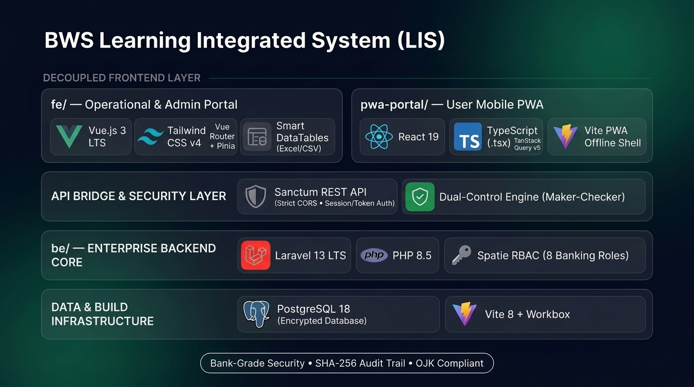

# Bank Woori Saudara (BWS) — Learning Integrated System (LIS)
## Enterprise Banking Decoupled Architecture & Tech Stack Handover

Dokumen ini merupakan panduan resmi penyerahan arsitektur teknis terpisah (*Decoupled Multi-Repository*) **BWS Learning Integrated System (LIS)** yang terdiri atas tiga aplikasi mandiri: **`be/`** (Backend REST API), **`fe/`** (Portal Operasional & Admin), dan **`pwa-portal/`** (Mobile PWA Karyawan).

---

### 1. Visualisasi Arsitektur Sistem



> [!NOTE]
> File infografis gambar resolusi tinggi tersimpan pada direktori proyek:
> `_dokumentasi/tech_stack_architecture_v2_bws_lis.jpg`

---

### 2. Struktur Direktori Proyek Terpisah

```
bws-lim/
├── be/                  # Backend Enterprise REST API (Laravel 13 LTS + PHP 8.5 + PostgreSQL 18 + Sanctum)
├── fe/                  # Frontend Portal Operasional & Admin (Vue.js 3 LTS + Vite + Pinia + Vue Router + Smart DataTable)
├── pwa-portal/          # Frontend Portal Belajar Karyawan Mobile PWA (React 19 + TypeScript + TanStack Query + Vite PWA)
└── _dokumentasi/        # Dokumentasi Arsitektur, Infografis, dan HTML Mockup
```

---

### 3. Rincian Tech Stack per Aplikasi

| Direktori | Peran Sistem | Teknologi / Framework | Fitur & Standar Utama |
| :--- | :--- | :--- | :--- |
| **`fe/`** | Portal Operasional & Admin | **Vue.js 3.5 LTS + Vite + Pinia + Vue Router + Tailwind CSS v4** | 10 modul operasional diklat dengan komponen tabel standar (`DataTable.vue`: *Search Bar*, *Date Range Filter*, *Column Sorting*, *Numbering*, *Pagination*, dan *Checkbox Selective Export ke Excel & CSV*). |
| **`pwa-portal/`** | Portal Belajar Pegawai (Mobile PWA) | **React 19 + TypeScript (.tsx) + TanStack Query v5 + Vite PWA** | Aplikasi mobile installable dengan *Workbox Offline App Shell*, target 20 jam pelatihan perbankan, pengumpulan tugas *Action Plan*, dan e-sertifikat QR Code. |
| **`be/`** | Core Backend & Security API | **Laravel 13 LTS (PHP 8.5) + Laravel Sanctum + Spatie RBAC** | REST API aman dengan CORS ketat, *RateLimiter* anti brute-force, otorisasi 8 peran perbankan, *Dual-Control Maker-Checker*, dan *SHA-256 Immutable Audit Trail*. |
| **Database** | Penyimpanan Utama | **PostgreSQL 18 Enterprise** | Integritas referensial ACID penuh dengan foreign key cascade dan manajemen token Sanctum. |

---

### 4. Cara Menjalankan Masing-Masing Aplikasi

Buka 3 terminal terpisah untuk menjalankan seluruh ekosistem secara bersamaan:

#### 1) Menjalankan Backend API (`be/`)
```bash
cd be
php artisan serve
# Berjalan pada: http://127.0.0.1:8000
```

#### 2) Menjalankan Frontend Operasional Vue 3 (`fe/`)
```bash
cd fe
npm run dev
# Berjalan pada: http://localhost:5173 (otomatis proxy /api -> http://127.0.0.1:8000)
```

#### 3) Menjalankan Portal Mobile PWA React TypeScript (`pwa-portal/`)
```bash
cd pwa-portal
npm run dev
# Berjalan pada: http://localhost:5174 (otomatis proxy /api -> http://127.0.0.1:8000)
```

---

### 5. Kredensial Demo & Pengujian Otomatis

- **Akun Demo (1-Klik Login pada Halaman Login FE & PWA)**:
  - Email Admin / Maker / Checker / Dept Head / Peserta (contoh: `admin@bws.co.id`, `peserta@bws.co.id`)
  - Password default: `password123`
- **Verifikasi Test Backend**:
  ```bash
  cd be
  php artisan test
  ```
